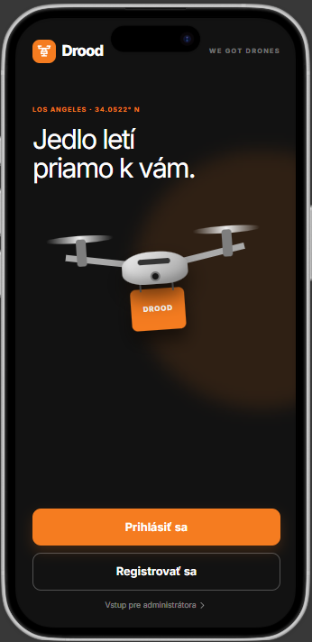
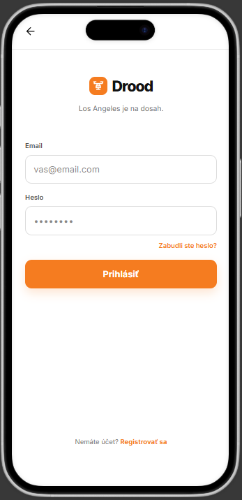
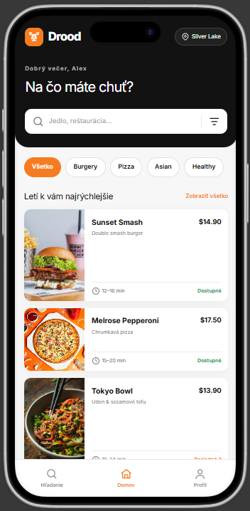
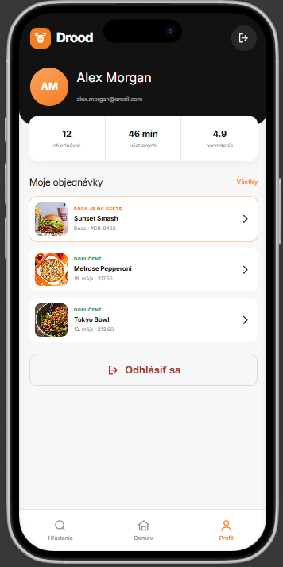

# Drood - Drone Food Delivery App

Drood je moderná mobilná aplikácia navrhnutá pre autonómne doručovanie jedla pomocou dronov priamo k zákazníkovi. Aplikácia umožňuje používateľom jednoducho si prezerať ponuku reštaurácií, zadávať objednávky a v reálnom čase sledovať stav doručenia ich obľúbeného jedla vzdušnou cestou. Vďaka intuitívnemu dizajnu a prehľadnému zákazníckemu profilu poskytuje Drood rýchly, pohodlný a inovatívny zážitok z donášky jedla.

## Obrazovky aplikácie (Figma Make)

| Obrazovka Vítania | Prihlásenie | Hlavné Menu | Užívateľský Profil |
| :---: | :---: | :---: | :---: |
|  |  |  |  |

## Authors

- Adam Tomčák (3.SA)
